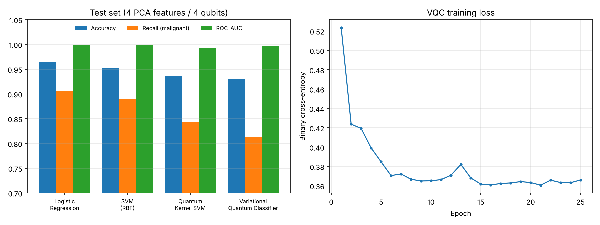

# Quantum ML for breast cancer diagnosis

I wanted to see how quantum machine learning models actually compare to ordinary classical
ones on a real medical dataset, without the hype. So I took the Wisconsin Diagnostic Breast
Cancer dataset and trained two quantum models (a quantum kernel SVM and a variational
quantum classifier) next to logistic regression and an RBF-SVM.

Everything runs on PennyLane's simulator, no quantum hardware or account needed.

## Data

569 biopsies (fine-needle aspirates), 30 features computed from the cell nuclei in the
images (radius, texture, concavity, ...), labelled malignant or benign. It ships with
scikit-learn so there's nothing to download. 70/30 stratified train/test split.

With 4 qubits I can only feed 4 numbers per patient, so the 30 features go through PCA down
to 4 components (79% of the variance kept), then get rescaled to [0, π] to be used as
rotation angles. The classical models get exactly the same 4 features, otherwise the
comparison wouldn't mean much.

## Models

- **Logistic regression** and **RBF-SVM** from scikit-learn as baselines.
- **Quantum kernel SVM**: each patient is encoded into a 4-qubit state with a ZZ-style
  feature map (Hadamards, RZ rotations, IsingZZ couplings between neighbouring qubits, repeated
  twice). The kernel is the overlap between two encoded states, `|<φ(x)|φ(x')>|²`, and goes
  into a normal SVM as a precomputed kernel.
- **Variational quantum classifier (VQC)**: RY encoding, then 3 layers of trainable rotations
  with CNOT entanglers (`StronglyEntanglingLayers`), and the prediction comes from ⟨Z⟩ on the
  first qubit. 37 trainable parameters, trained with Adam on binary cross-entropy for 25 epochs.

I report recall on the malignant class next to accuracy, because in this setting a missed
cancer is much worse than a false alarm.

## Results

Test set, 171 patients (64 malignant):

| Model | Accuracy | Recall (malignant) | F1 | ROC-AUC | Missed cancers |
|---|---|---|---|---|---|
| Logistic regression | 0.965 | 0.906 | 0.951 | 0.998 | 6 |
| SVM (RBF) | 0.953 | 0.891 | 0.934 | 0.998 | 7 |
| Quantum kernel SVM | 0.936 | 0.844 | 0.908 | 0.993 | 10 |
| VQC | 0.930 | 0.812 | 0.897 | 0.996 | 12 |



## What I take from it

Both quantum models clearly learn the problem (AUC above 0.99, and the VQC does it with only
37 parameters), but neither beats the classical baselines. The difference shows up mostly in
recall: the VQC misses 12 of the 64 malignant cases where logistic regression misses 6.
Its AUC is still high, so part of that is the 0.5 threshold, and lowering it would trade
some false alarms for fewer missed cancers.

I don't think this is a tuning issue . A few reasons:

- The bottleneck is getting the data in. 4 qubits meant dropping 21% of the variance before
  any model saw the data. Encoding classical data into quantum states efficiently is still an
  open problem in QML.
- This dataset is close to linearly separable, so the huge feature space a quantum kernel
  gives you doesn't buy much. Logistic regression winning is a hint about that.
- This is a perfect noiseless simulation. On real hardware you'd get shot noise and gate
  errors on top, so these numbers are an upper bound.

So for classical tabular medical data I'd keep using classical models for now. Where quantum
computing looks more promising in healthcare is on problems that are quantum in nature, like
simulating molecules for drug discovery.

## Running it

```
pip install -r requirements.txt
python run.py
```

Takes about 20 seconds on a laptop. Metrics go to `results/metrics.json`, the plot to
`figures/comparison.png`.

## Files

- `quantum_models.py`: the quantum kernel and the VQC
- `run.py`: data prep, training of the four models, evaluation and plotting

## Ideas for later

- 8 qubits / 8 PCA components, to see if the gap closes when less information is thrown away
- shot noise (`shots=1000`) and a noise model to get closer to real hardware
- tune the decision threshold for ≥95% recall and look at the precision cost
- several random seeds with mean ± std instead of a single split
- run the kernel on IBM hardware for a small subset
